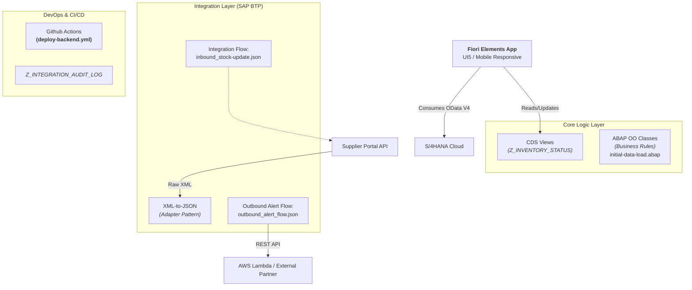

# SAP Extensibility Hub CPI Adapter Supplier (Sandbox)

# [DE](README.md) | [EN](README.EN.md)

# 📦 Inventory Optimization Dashboard (Legacy-to-Cloud Migration)

**Project Type:** SAP S/4HANA Cloud ModernizatioN 
**Tech Stack:** Fiori Elements/UI5, ABAP on HANA (CDS), SAP BTP Integration Suite, GitHub Actions  

---

## 🚀 Executive Summary
This project demonstrates a critical **Legacy System Modernization**: migrating from an older ECC6 architecture to a cloud-native S/4HANA environment. This extends to the additional layer for ensuring integration between traditional ERP data and modern RESTful consumption patterns using **CDS Views**, **Integration Flows (API Mediator)**, and **Responsive Fiori UI5**.

The dashboard solves abstract (for topic) business problems by monitoring stock levels in real-time, automatically alerting suppliers via external APIs when inventory dips below thresholds, and providing a mobile-friendly interface for warehouse managers.

---

## 🏗️ Architecture Overview

### Key Technical Highlights:
1.  **Data Model:** Replaced direct `SELECT` statements with annotated CDS Views (`@VDM`) for high-performance HANA queries and seamless Fiori consumption.
2.  **Integration Resilience:** Implements a robust "Retry-Policy" in outbound flows to handle transient API failures without blocking users, logging events directly to an Audit Table.
3.  **Mobile First:** The UI adapts automatically using SAP UI5 Responsive Variants (XL/L/M/S), ensuring warehouse staff can manage stock on tablets or phones.

---

## 📂 Project Structure [structure_overview](inventory-optimization-dashboard/docs/structure_overview.md)

## 🛠️ Setup Instructions

### Prerequisites
1.  **SAP BTP Account** with Access to Integration Suite & ABAP Environment (Side-by-Side).
2.  **VS Code Extension Pack:** SAP Business Application Studio or standard extensions (`redhat.java`, `sap.ui5`).
3.  **Git Hub Repository** linked for CI/CD triggers.

### Installation Steps

## 🎯 Key functional requirements expeted be Implemented

| Feature | Description | Technology Used |
| :--- | :--- | :--- |
| **Smart Stock Filtering** | Automatically filters materials with stock < threshold using CDS View annotations. | HANA SQL Optimizer, @VDM |
| **Legacy Adapter Pattern** | Transforms raw XML from legacy suppliers into clean JSON for S/4HANA ingestion. | Integration Suite (Message Mapping) |
| **Self-Healing Integrations** | Automatically retries failed outbound alerts and logs failures to an audit table if retry limit exceeded. | Exception Handler, Retry Policy |
| **Responsive UI** | Seamlessly switches between List View (Desktop) and Tile/Grid Layouts (Mobile/Tablet). | SAP Fiori Elements Adaptivity API |
| **Audit Trail Compliance** | Every integration flow writes a hashed entry to `Z_INTEGRATION_AUDIT_LOG` for compliance auditing. | SAP Audit Framework, SHA256 Hashing |

