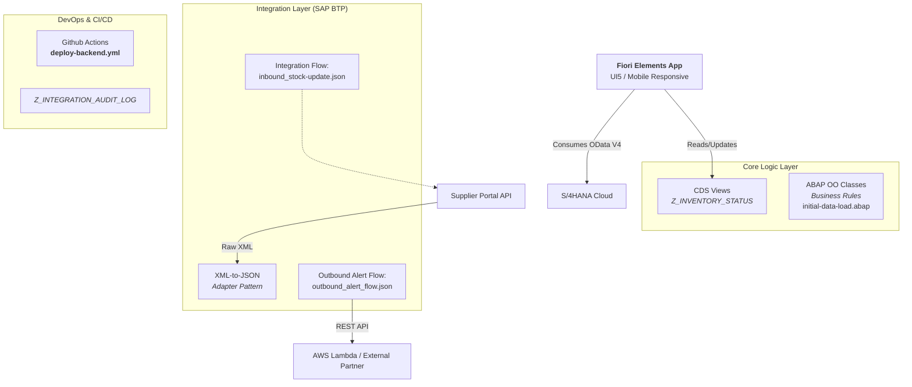

# SAP Extensibility Hub CPI Adapter Supplier (Sandbox)

# 📦 Dashboard zur Optimierung des Warenbestands (Migration vom Legacy- zum Cloud-Umfeld)


**Projekttyp:** Modernisierung von SAP S/4HANA Cloud  
**Technologie-Stapel:** Fiori Elements/UI5, ABAP on HANA (CDS), Integration Suite für SAP BTP, GitHub Actions  


---


## 🚀 Zusammenfassung
Dieses Projekt demonstriert eine wesentliche **Modernisierung eines Legacy-Systems**: Die Migration von einer älteren ECC6-Architektur in ein cloud-natives S/4HANA-Umfeld. Dies schließt zusätzliche Ebenen ein, um die Integration zwischen traditionellen ERP-Daten und modernen RESTful-Konsumentenmustern mittels **CDS Views**, **Integration Flows (API Mediator)** und **responsiver Fiori UI5** sicherzustellen.

Der Dashboard löst abstrakte geschäftliche Herausforderungen durch Echtzeit-Überwachung der Lagerbestände, automatische Warnung von Lieferanten über externe APIs bei Unterschreitung bestimmter Bestandschwellen sowie eine mobilefreundliche Schnittstelle für das Lagerteilpersonal.


---

Wir nutzen [Diskussionen](https://github.com/Logic-HQ/SAP-Extensibility-Hub-CPI-Adapter-Supplier-Fork/discussions/1) als Plattform.


## 🏗️ Architekturübersicht




### Wichtige technische Highlights:
1.  **Datenmodell:** Direkte `SELECT`-Anweisungen wurden durch annotierte CDS Views (`@VDM`) ersetzt, um hochoptimierte HANA-Abfragen und nahtlose Fiori-Konsumption zu gewährleisten.
2.  **Integrationsresilienz:** Implementierung einer robusten „Retry-Policy" in ausgehenden Flows zur Handhabung vorübergehender API-Fehler ohne Blockade der Benutzer; Ereignisse werden direkt in eine Audit-Tabelle protokolliert.
3.  **Mobile First:** Die Benutzeroberfläche passt sich automatisch an, indem SAP UI5 Responsive-Varianten (XL/L/M/S) verwendet werden, sodass das Lagerteilpersonal Bestände auf Tablets oder Smartphones verwalten kann.


---


## 📂 Projektstruktur

# Entwurf einer strukturierten Mapping-Konfiguration

---

## Kernlogik zur Integration: integration-cpi/flows/inbound_stock_update.json


Dies ist eine simulierte Darstellung der Konfiguration einer Mapping-Knoten, die das Umwandeln eines externen XML-Datensatzes eines Lieferanten in interne HANA-Strukturen steuert.


Ein Annotation-Knoten oder ein Mapping-Knotenzubehör existiert (z. B. stellt `@Vdm 'true'` sicher, dass Fiori Elements das Benutzeroberflächeninterface automatisch generieren kann).

```ASCII
Lieferanten-API -> [CPI-Mapping-Knoten] -> Z_INVENTORY_STATUS (CDS-Ansicht) -> Fiori-App
            ↑                                    |           ↑
        (Transformationlogik)               (Datenmodell)    (Visualisierungsschicht)
```

## 🛠️ Installationsanleitung


### Voraussetzungen
1.  **SAP BTP-Konto** mit Zugriff auf Integration Suite & ABAP-Umfeld (Side-by-Side).
2.  **VS Code-Erweiterungs-Pack:** SAP Business Application Studio oder Standard-Extensionen (`redhat.java`, `sap.ui5`).
3.  **GitHub-Repositorium**, das für CI/CD-Auslöser verknüpft ist.


### Installationschritte

## [Spezifikation des Datenmodells](https://github.com/ValentinaTech/SAP-Extensibility-Hub-CPI-Adapter-Supplier/blob/main/inventory-optimization-dashboard/docs/data-model-specification.md)

## 🎯 Wesentliche funktionale Anforderungen zur Implementierung:

| Feature | Beschreibung | verwendete Technologie |
| :--- | :--- | :--- |
| **Intelligente Bestandsfilterung** | Filtert automatisch Materialien mit einem Bestand unter der Schwelle aus, dank CDS-View-Annotierungen. | HANA SQL Optimizer, @VDM |
| **Legacy Adapter-Muster** | Wandelt rohe XML-Daten von Legacy-Lieferanten in sauber formatiertes JSON um für die S/4HANA-Aufnahme. | Integration Suite (Nachrichtenabbildung) |
| **Selbstheilende Integrationen** | Führt automatische Wiederholungsversuche bei fehlgeschlagenen ausgehenden Warnungen durch und protokolliert Fehler in einer Audit-Tabelle, wenn das Retry-Limit überschritten wird. | Exception Handler, Retry Policy |
| **Responsive UI** | Wechselnahtlos zwischen Listenansicht (Desktop) und Kachel-/Rasterlayouts (Mobile/Tablet). | SAP Fiori Elements Adaptivity API |
| **Compliance für Prüfpfade** | Jeder Integrationsflow schreibt einen verschlüsselten Eintrag in `Z_INTEGRATION_AUDIT_LOG` zur Sicherstellung der Compliance. | SAP Audit Framework, SHA256-Verschlüsselung |
